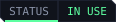
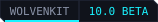

<p align="center">
  
</p>

<p align="center">
  <a href="https://edgemodders.github.io/REDbridge/"></a>
  
  
  
  <a href="LICENSE"></a>
</p>

The engine host for [REDcode](https://github.com/Edgemodders/REDcode), a Cyberpunk 2077 modding IDE built on VS Code.

REDbridge runs [WolvenKit](https://github.com/WolvenKit/WolvenKit)'s headless C# libraries in a local process and exposes them over JSON-RPC: archive browsing, CR2W files as JSON and back, texture, mesh and audio conversion, TweakDB queries, on-screen texts and spoken lines, import, export and packing. REDcode's extension was its first client. [EDGEdeck](https://github.com/Edgemodders/EDGEdeck) (conflicts inside mod archives), [REDnode](https://github.com/Edgemodders/REDnode) (sound names in the Sound Tools, and `kernel.bridge()` for mods) and other Edgemodders tools use it too. AI assistants reach the same methods through REDcode's MCP server, `redcode-mcp`, which starts the bridge and talks to it over stdio as the extension does.

**[Read the docs](https://edgemodders.github.io/REDbridge/)** &middot; [REDcode](https://github.com/Edgemodders/REDcode) &middot; [REDnode](https://github.com/Edgemodders/REDnode)

> [!NOTE]
> **Status: released and in use.** The latest release is [0.10.0](https://github.com/Edgemodders/REDbridge/releases/latest), built with WolvenKit 9.1.0. It is checked against game **2.31**. Game 2.5 (out on 2026-10-22) reads mostly, but not every file: see [issue #10](https://github.com/Edgemodders/REDbridge/issues/10). `tools/probe.py` runs every method against a real install.

## Get REDbridge

Players and modders rarely install REDbridge by hand. The tools that use it fetch it for you:

| Tool | How | Where it goes |
|---|---|---|
| REDcode (VS Code) | Command **REDcode: Install REDbridge**, later **Update REDbridge** | REDcode's storage; it sets `redcode.bridgePath` |
| EDGEdeck (VS Code) | **Get REDbridge** in its view, or the command of that name | EDGEdeck's storage (`edgedeck.bridgePath` empty means that copy) |
| REDnode (in the game) | The Mod Manager's **Get REDbridge** button | `%LOCALAPPDATA%\REDnode\bridge`, with .NET 10 per user |

REDnode also finds the copy in EDGEdeck's or REDcode's storage, so one install serves all three. To install by hand, download `REDbridge-<version>-win-x64.zip` from [Releases](https://github.com/Edgemodders/REDbridge/releases) and unzip it anywhere. It needs the .NET 10 runtime (`winget install --id Microsoft.DotNet.Runtime.10 -e`) and Windows x64.

## How it works

```
 VS Code (REDcode extensions)      REDbridge (.NET 10)                 WolvenKit libraries
 ┌───────────────────────────┐     ┌────────────────────────────┐     ┌────────────────────┐
 │ archive browser           │     │ JSON-RPC 2.0 over stdio    │     │ RED4: CR2W, archives│
 │ CR2W editor               │◄───►│ method groups: archive,    │◄───►│ Common: JSON, DDS   │
 │ import / export / pack    │     │ cr2w, texture, project,    │     │ Modkit: glTF, pack  │
 │ AI assistants via MCP     │     │ tweakdb, sound, loc, hash  │     │ Core: Oodle, hashes │
 └───────────────────────────┘     └────────────────────────────┘     └────────────────────┘
                                    big outputs (PNG, glTF, WAV) go to files the client names; RPC returns paths
```

Every method, by group. Each name is `<group>.<method>`, for example `archive.list`.

| Method group | Methods | Backed by |
|---|---|---|
| `bridge` | info: the bridge's version, its WolvenKit version, the game folder and whether its archives are loaded | |
| `archive` | load (a game folder, when the bridge was started without one), archives, list, search, tree, extract, extractMany, openMod and extractFromMod (a mod's .archive anywhere on disk, no game needed) | WolvenKit.RED4 |
| `cr2w` | toJson, fromJson, fileToJson; document sessions: open, getNode, getNodes, search, patch, save, close, documents, describeType, createInstance | WolvenKit.RED4, WolvenKit.Common |
| `texture` | toPng (a game texture), fileToPng (an `.xbm` on disk), imageToPng (a plain TGA, DDS, TIFF, BMP, JPG or PNG to PNG, for viewing). Meshes to glTF and sounds to WAV go through `project.export` | WolvenKit.Common |
| `mesh` | info, infoMany: a mesh's or an entity template's bounds and appearance names, for an asset index | WolvenKit.RED4 |
| `sector` | build: an EDGEbuilder scene into a streaming sector, a streaming block and an ArchiveXL file in a REDcode project | WolvenKit.RED4 |
| `project` | pack (a folder into `<modName>.archive` through WolvenKit's packer, with warnings for paths with capital letters or spaces); export (a file under `source/archive` to the same path under `source/raw`: glTF, an image, WAV and so on) and import (back again, an existing texture keeping all its settings; a GLB over a `template` mesh for a new asset, 0.9.0; an image with a `texture` setup, a preset `color`, `normal` or `grayscale` or the setup's fields, reporting the setup written), each listing the files written | WolvenKit.Modkit |
| `tweakdb` | types, records (by type, subtypes included, or path prefix, with chosen flats and LocKey text), record, flat, search, names (ids to paths, no load needed). Read offline from the game's `tweakdb_ep1.bin`, loaded on the first call in about 12 s | WolvenKit.RED4 |
| `sound` | events: the sound event names WolvenKit knows, with their Wwise hashes, which name the event groups in `sfx_container.opusinfo`; importWavs: override game sound effects in a project from `<hash>.wav` files, writing the changed `.opuspak` files and a new index into its `source/archive` (0.9.0) | WolvenKit.Modkit's `soundEvents.json`, `OpusInfo` and opus-tools |
| `loc` | languages, search (by LocKey, secondary key or words in the texts), get (by LocKey or secondary key): the on-screen texts of the base game and Phantom Liberty, read offline, with a project's own onscreens files laid over them (the ones its `.xl` files name, and any under a language folder); projectFiles (those files for a language); newFile (an empty onscreens file for a project, named in an `.xl`). Spoken lines (for EDGEquest): lines (by stringId, a scene line's `locstringId.ruid`, with the subtitle texts, the `.wem` voice-over files from the voice-over maps and the lengths), searchLines (by words in the texts), projectLinesFiles and newLinesFile (a project's subtitle files, named in an `.xl` under `localization: subtitles:`), with a project's own subtitle files laid over the game's in the same way | WolvenKit.RED4 |
| `hash` | fnv1a64, resolve | WolvenKit.Core |
| `script` | not planned: REDcode dropped its script runner | |

The spoken lines (`loc.lines`, `loc.searchLines`, `loc.projectLinesFiles`, `loc.newLinesFile`) and `project.import`'s `texture` setup are on `main`, not yet in a release, and not yet tried in the game.

## Talking to the bridge

For a client of your own. REDcode's [`bridgeClient.ts`](https://github.com/Edgemodders/REDcode/blob/main/extensions/redcode/src/bridgeClient.ts) (MIT, no VS Code imports) is a working example.

| What | How |
|---|---|
| Start | `REDbridge.exe [--game "<Cyberpunk 2077 folder>"]`. Without `--game`, the `REDBRIDGE_GAME` environment variable is used. A per-user .NET needs `DOTNET_ROOT` set for the process (see the [setup guide](https://edgemodders.github.io/REDbridge/dev-setup.html#net-runtime-location)) |
| Protocol | JSON-RPC 2.0 on stdin and stdout, each message framed with a `Content-Length` header, as language servers do. Parameters by name, keys in camelCase |
| Log | stderr. Nothing else writes to stdout |
| No game | Methods that read the game's files answer "No game loaded" until `archive.load` is called. `archive.openMod`, `archive.extractFromMod`, `hash.*`, `tweakdb.names`, `sound.events`, `project.pack`, `cr2w.fileToJson`, `cr2w.fromJson` and `cr2w.open` with a `file` need no game |
| Stop | Close stdin; the bridge exits when the client disconnects |

## Mesh import

A GLB or glTF becomes a `.mesh` only over an existing one: WolvenKit's importer has no direct mesh import. For a new asset, `project.import` takes a `template`, a game path or a `.mesh` on disk, which it copies to the target first. A mesh already at the target is imported over as it is, so re-imports keep later changes. What a GLB import does to the mesh, from WolvenKit 9.1.0's `MeshImportTools.ImportMesh` (checked against the game's files, not yet in the game):

| Part of the mesh | After the import |
|---|---|
| Geometry | From the GLB: one submesh per node with a mesh, sorted by node name, its first primitive. The GLB must have normals and tangents (Blender: export Tangents) and triangles; a node name with `LOD_1`, `LOD_2`, `LOD_4` or `LOD_8` sets its LOD |
| Bounds | Recomputed from the GLB |
| Material entries and the materials | The template's, unchanged. The GLB's materials are ignored, unless a `.Material.json` WolvenKit wrote lies beside it |
| Appearances | The template's names. Each one's `chunkMaterials` is sized to the new submesh count by the bridge, since WolvenKit leaves it as it was: a submesh keeps the material at its index, or the last one |
| Rig and bones | The template's bone set, grown from the GLB's skin when its joints carry rotations |
| Garment support | Rebuilt from the GLB when garment-support data is in it |

The result's `mesh` field reports the submesh count, the GLB's material names per submesh (the materials for EDGEmat to make), the mesh's material entries, its appearances and what was resized. WolvenKit's own GLB exports name their materials `Default`.

## Texture import

An image imported over an existing `.xbm` keeps that texture's setup. A new one gets WolvenKit's plain defaults (`TEXG_Generic_Color`, `TCM_None`, gamma off), unless `project.import` is given a `texture` setup. The presets use the defaults WolvenKit gives each texture group (`CommonFunctions.TextureSetupFromTextureGroup`, WolvenKit 9.1.0):

| `texture` | Group | Compression | Raw format | Gamma | Mipmaps |
|---|---|---|---|---|---|
| `"color"` | `TEXG_Generic_Color` | `TCM_QualityColor` | `TRF_TrueColor` | on | on |
| `"normal"` | `TEXG_Generic_Normal` | `TCM_Normalmap` | `TRF_TrueColor` | off | on |
| `"grayscale"` | `TEXG_Generic_Grayscale` | `TCM_QualityR` | `TRF_Grayscale` | off | on |

A texture group name works the same way (`"TEXG_Generic_Data"`). An object, `{ "group": "TEXG_Generic_Normal", "compression": "TCM_Normalmap", "isGamma": false, "hasMipchain": true }`, sets any of `group`, `compression`, `rawFormat`, `isGamma`, `hasMipchain` and `isStreamable`; the rest come from its group. A given setup wins over the existing texture's. The result's `texture` is the setup read back from the `.xbm`. Checked by the probe against WolvenKit's reader, not yet in the game.

## Repository layout

| Path | Contents |
|---|---|
| `docs/` | Documentation site |
| `tools/brand/` | Generates the banner, badges and icon |
| `src/REDbridge/` | The bridge: host, RPC surface, stderr logger |
| `tools/probe.py` | Stdlib Python client that runs every method over the real protocol |
| `tools/wolvenkit-source.mjs` | Fetches WolvenKit's source at the version the bridge uses into `external/WolvenKit`, for reading (`npm run wolvenkit:source`) |
| `tools/dotnet.mjs` | Finds the .NET SDK for the npm scripts |
| `tools/release-notes.mjs` | Prints a release's GitHub notes from `CHANGELOG.md` (`npm run release:notes`) |
| `CHANGELOG.md` | What changed in each release |

## Build

```powershell
git clone https://github.com/Edgemodders/REDbridge.git
cd REDbridge
npm run build:full                              # restore, then build
npm run probe -- "<Cyberpunk 2077 folder>"      # exercise every method against a game install
```

WolvenKit comes from its own NuGet packages (`WolvenKit.Core`, `.RED4`, `.Common`, `.Modkit`), at the version in `WolvenKitVersion` in `src/REDbridge/REDbridge.csproj`. Dependabot opens a pull request for each new WolvenKit release, the Build workflow checks that it compiles, and the probe is run against the game before it is merged. Later, `npm run update` pulls and rebuilds, and `npm run build` rebuilds after local changes. The scripts only wrap `dotnet` and `git`; `package.json` shows the exact commands. Needs the .NET 10 SDK, Node and Python 3. Details, including the per-user SDK route without administrator rights, are in the [setup guide](https://edgemodders.github.io/REDbridge/dev-setup.html).

## Roadmap

- **C0 Decide.** Build WolvenKit's headless libraries locally and confirm what the bridge references. Agree the approach with the WolvenKit team.
- **C1 Bridge MVP.** `archive.list`, `cr2w.toJson`, `cr2w.fromJson`, `texture.toPng`, `hash.*` over stdio. Proves the data path with REDcode.
- **C2 to C4.** Method groups for browsing, editing, import, export and packing, as REDcode's extensions need them.
- **C5.** Methods for REDcode's viewers: audio (`sound.events`, 0.7.2) TweakDB (`tweakdb.*`, 0.8.0) and LocKeys (`loc.*`, 0.10.0). No script host: REDcode dropped its script runner (agents and MCP tools cover it). The MCP server lives in REDcode as [`redcode-mcp`](https://github.com/Edgemodders/REDcode/tree/main/packages/redcode-mcp), MIT, over stdio.

Phases follow the REDcode roadmap.

## Compatibility goals

REDbridge pins a WolvenKit version and tracks its releases. Changes that make WolvenKit's libraries easier to host are sent upstream. Windows only for now, because WolvenKit's texture tooling is. Each release is checked against one game version, 2.31 for now; a game patch can change file formats until WolvenKit catches up.

## Legal

REDbridge links WolvenKit's libraries, which are GPL-3.0, so REDbridge is GPL-3.0. REDcode's extensions talk to it only over stdio and keep their own license. This repository contains no game files and no data extracted from them. Single-player modding only.

## License

[GPL-3.0](LICENSE)
